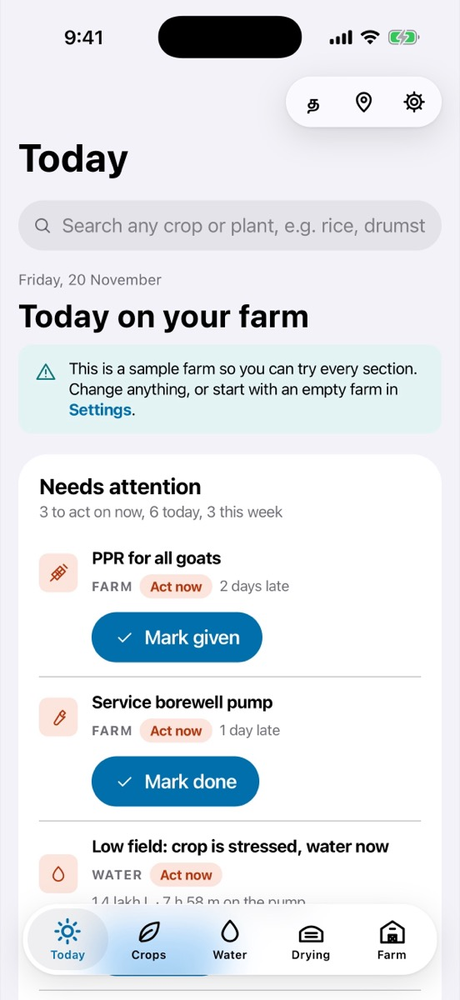
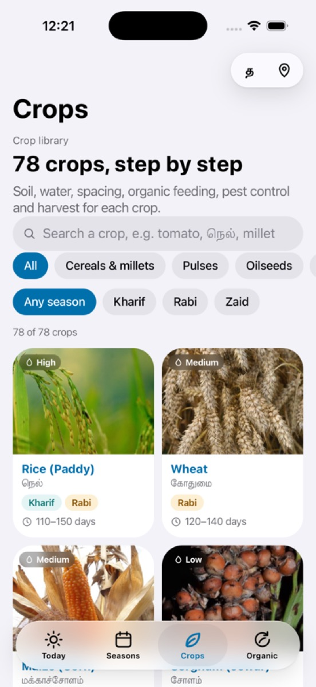
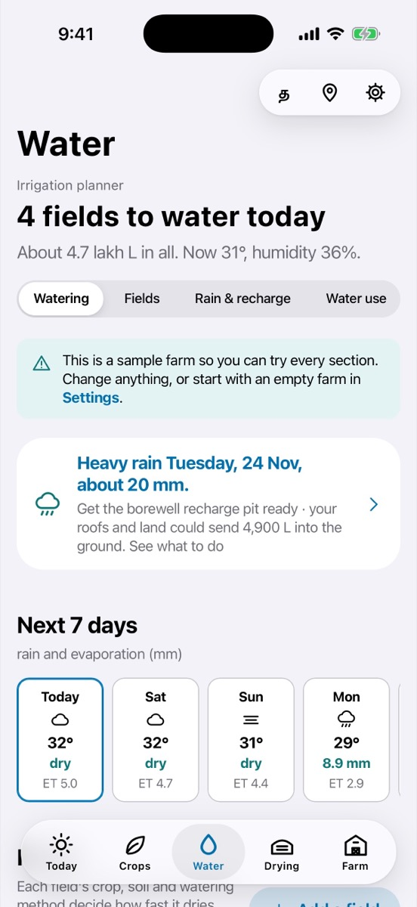
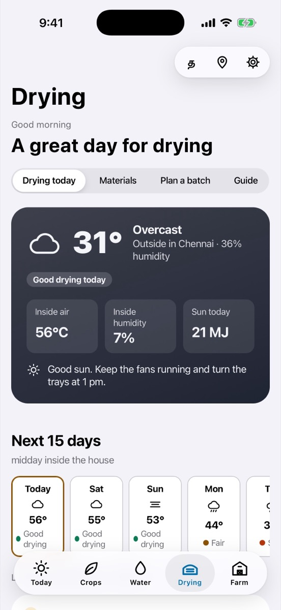
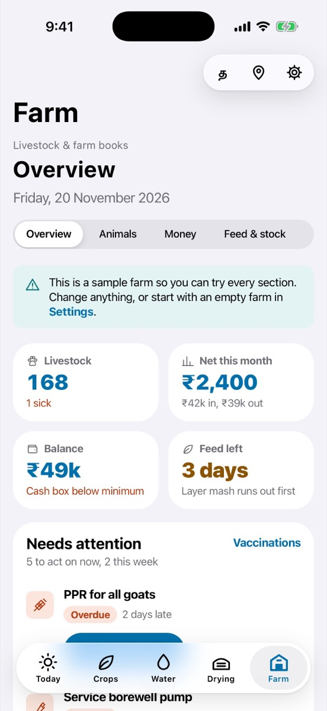

# FarmerFriend for iPhone

A native SwiftUI shell (WKWebView, iOS 17+) around the live web app at https://farmerfriend.vercel.app, generated from the
[Kolam iOS shell template](https://github.com/tgopinath/kolam-design-system/tree/main/ios/shell-template).
Inside this app the page switches to Apple's Human Interface Guidelines look (Kolam iOS kit: large titles,
Liquid Glass tab bar, back + centred title, sheets, haptics); in Safari or any other browser it keeps its Kolam look.
Web app source: https://github.com/tgopinath/farmer-friend

     

## Run it

```sh
xcodebuild -project *.xcodeproj -scheme $(basename *.xcodeproj .xcodeproj) \
  -destination 'platform=iOS Simulator,name=iPhone 17 Pro' -derivedDataPath build CODE_SIGNING_ALLOWED=NO build
```

Then install `build/Build/Products/Debug-iphonesimulator/*.app` with `xcrun simctl install booted …`.
Debug builds accept `-KolamStartURL "<url>"` on `simctl launch` to open another route.
Installing on other people's iPhones needs TestFlight or the App Store (Apple Developer Program).

## Location

The page's `navigator.geolocation` is answered by CoreLocation through a small bridge in `AppWebView.swift` (the same as SolarDryHouse-iOS), so "Use my location" shows one iOS permission prompt (`NSLocationWhenInUseUsageDescription`) and Water and Drying use the farm's own forecast.
